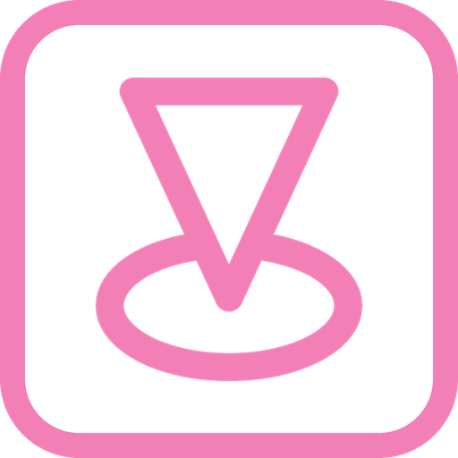
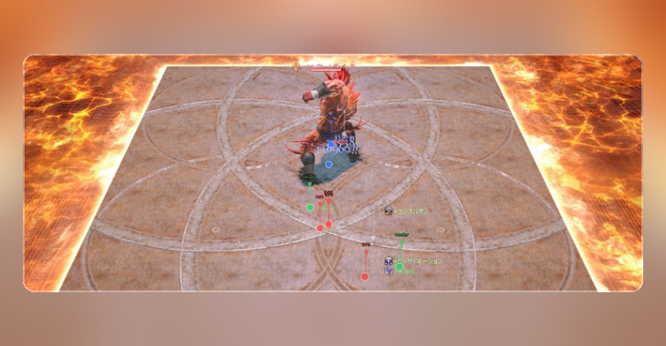

<p align="center">
  
</p>

<h1 align="center">Veilay</h1>

<p align="center">
  <a href="../README.md">English</a> | 日本語
</p>

<p align="center">
  <a href="https://github.com/exatrines/Veilay/releases/latest">
    
  </a>
  <a href="../CHANGELOG.md">
    
  </a>
  <a href="../LICENSE">
    
  </a>
</p>

<p align="center">
  
</p>

Veilay は、キャラクターモデルをローカルで隠し、選んだ HUD を消し、カメラを固定できる Dalamud プラグインです。主に Splatoon などの描画プラグインの作業を、モデルを隠したまま共有するためのものです。

プレイヤー／ペット／NPC／敵のモデルは、非表示にするか、ダミーに置き換えることができます。エンティティは残るので、Splatoon などは位置をそのまま追えます。ネイティブ HUD の非表示、戦闘エフェクトのオフ、固定カメラの配置もできます。

固定カメラは Cammy のフリーカメラと衝突します。そのため、両方を入れているときは注意が必要です。

## インストール

1. `/xlsettings` を実行し、**試験的機能**タブを開く
2. **カスタムプラグインリポジトリ** に次の URL を追加する:

```
https://raw.githubusercontent.com/exatrines/DalamudPlugins/refs/heads/main/pluginmaster.json
```

3. `/xlplugins` を実行し、**Veilay** をインストールする

## 機能

- **Models**：Enable Veilay で、Player / Pets / NPC / Enemy のモデルを非表示またはダミーに置き換え（エンティティは残す）。ネームプレートも非表示
- **Native**：HUD Layout の選択非表示。リプレイ中は戦闘エフェクト、ターゲットライン、フライテキスト、ポップアップテキストをオフ
- **Camera**：Center / Pos / Angle の固定。Cammy FreeCam との併用には注意

## コマンド

| コマンド | 説明 |
| --- | --- |
| `/veilay` | Veilay ウィンドウの表示切替 |

## 開発者向け

1. ビルド: `dotnet build Veilay.sln -c Release -p:Platform=x64`
2. Dalamud の **dev plugin** に `Veilay/bin/Release/` を指定する
3. プラグインインストーラ（dev）で **Veilay** を有効にする

## コントリビューション

コントリビューションは大歓迎です！[貢献ガイド](../CONTRIBUTING.md)をご覧ください。
